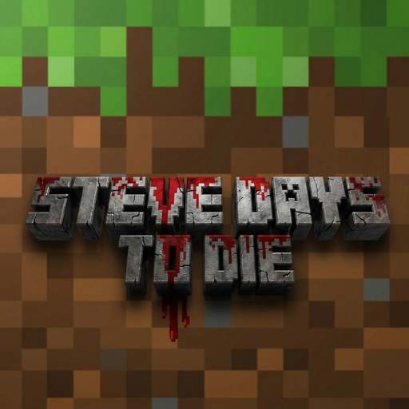

<p align="center"></p>

# Steve Days to Die

**ES —** 7 Days to Die jugado con las reglas de Minecraft: eres Steve (con tu propia skin), tu barra de pantalla es la de Minecraft, te cansas con el hambre y no con la resistencia, y pegar tiene barra de ataque y golpe crítico. Todo lo de Minecraft se lee de **tu propia copia instalada**; este proyecto no incluye ningún archivo de ninguno de los dos juegos.

**EN —** 7 Days to Die played with Minecraft's rules: you are Steve (with your own skin), your screen bar is Minecraft's, tiredness comes from hunger instead of stamina, and hitting has an attack bar and critical hits. Everything from Minecraft is read from **your own installed copy**; this project ships no file from either game.

> Estado / Status: **en desarrollo / work in progress.** Los pasos 1–3 están hechos; el inventario, el crafteo y el multijugador vienen después. Steps 1–3 are done; inventory, crafting and multiplayer come next.

## Cómo jugarlo / How to play
Necesitas **7 Days to Die** y **Minecraft: Java Edition** instalados (abre Minecraft una vez desde su launcher). Instálalo desde [Melty](https://melty.gg) y pulsa **Play**: Melty lo instala, lo actualiza solo y abre 7 Days con el mod cargado. Para jugar 7 Days normal, ábrelo desde Steam como siempre.

You need **7 Days to Die** and **Minecraft: Java Edition** installed (start Minecraft once from its launcher). Install it from [Melty](https://melty.gg) and press **Play**: Melty installs it, updates it by itself and starts 7 Days with the mod loaded. To play plain 7 Days, start it from Steam as usual.

**Sin Melty / Without Melty:** descarga `SteveVsZombies.exe` del [último release](https://github.com/podselxd/steve-days-to-die/releases) y ábrelo: pulsa **JUGAR** y él instala o actualiza el mod y abre el juego (deja un acceso directo en el escritorio). En sus pestañas eliges tu **skin** (en 3D), los **efectos** de 7 Days que quieras (sangrado, huesos rotos, infección… apagados por defecto) y tus **teclas**. Windows puede avisar con SmartScreen la primera vez: "Más información" → "Ejecutar de todas formas". Download `SteveVsZombies.exe` from the latest release, open it and press **JUGAR**; it installs or updates the mod and starts the game.
## Qué trae hoy / What it does today
- Steve construido con tu skin (o `skin.png`, o el Steve de tu Minecraft), con la animación de caminar de Minecraft; brazo derecho en primera persona.
- Corazones, comida, barra de 9 casillas (la 10ª de 7 Days no existe), mira y nombre del objeto, con las texturas de tu Minecraft.
- Barra de ataque con el ritmo de cada arma (35 armas y herramientas), golpe crítico al caer.
- Hambre de Minecraft: saturación, no correr con 6 de comida o menos, la vida vuelve con la comida llena.
- Espejo: una ventana pequeña que te muestra a Steve de frente (tecla `Insert`).
- Puntos de armadura sobre los corazones.
- Sin heridas de 7 Days: nada de sangrado, aturdimiento, lentitud por golpes ni piernas o brazos rotos (se pueden encender en el launcher, pestaña Efectos).
- La tecla 0 alterna un objeto entre 7 Days y Minecraft.
- Doble toque de W para correr; solo suena el golpe de Minecraft al recibir daño.

## Ajustes / Settings
`%LOCALAPPDATA%\SteveDaysToDie\ajustes.cfg` (se crea solo): versión de Minecraft, Steve sí/no, ataque de Minecraft, cansancio por hambre, regeneración, sed, teclas.

## Para desarrolladores / For developers
Las hojas en `sheets/` son la fuente de verdad (pares de objetos, ritmo de ataque, hambre, armadura). `tools/*.py` leen los archivos de tu propia instalación para generar las tablas; lo generado a partir del juego no se sube.
```
python tools/build_config.py     # hojas -> Config/items.xml + src/Generated/*.cs
python tools/preflight.py --mark # debe decir PREFLIGHT LIMPIO
dotnet build SteveDaysToDie.csproj -c Release
```
`melty.json` es la receta de instalación que lee Melty. Cada versión nueva se publica adjuntando `SteveVsZombies-<versión>.zip` a un release de GitHub.

## Licencia / License
Pendiente: el autor aún no ha elegido licencia. Until the author picks a license, all rights are reserved.
